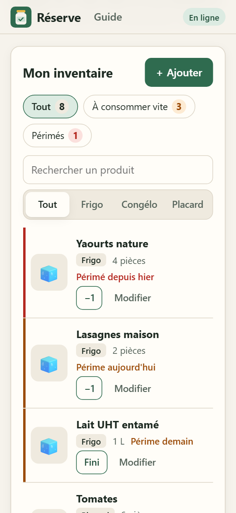
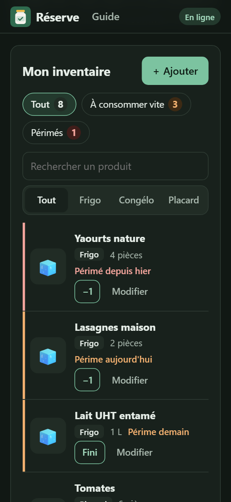

# Réserve — l'inventaire du garde-manger, même hors ligne

Réserve note ce qu'il y a dans le réfrigérateur, le congélateur et le placard, avec les dates de péremption. L'application s'installe sur le téléphone, fonctionne sans réseau, se partage entre les membres du foyer et envoie chaque matin un rappel des produits à consommer vite.

- **Application** : *‹ https://votre-site.netlify.app ›*
- **Document technique** : [DOC-TECHNIQUE.md](DOC-TECHNIQUE.md)
- Projet du TP PWA, M2 Informatique, Università di Corsica.

 

## Ce que fait l'application

| Brique du TP | Dans Réserve |
|---|---|
| Installable | Manifest complet (icônes 192, 512 et maskable, raccourcis, captures d'écran), bouton « Installer », astuce pour iOS |
| Hors ligne | App Shell en cache versionné, inventaire dans IndexedDB, page de secours, actions réseau désactivées et signalées |
| Mise à jour | Bannière « Nouvelle version » ; version du cache calculée au build |
| Synchronisation | Outbox IndexedDB, Background Sync et repli `online`, partage entre les appareils du foyer |
| Visible | Guide de conservation (30 aliments, FAQ, sources) dans le HTML, JSON-LD, `robots.txt`, `sitemap.xml`, `llms.txt`, jumelles Markdown |
| Capacités | Caméra (photo, lecture du code-barres), badge sur l'icône, partage de la liste de courses |
| Bonus | Notifications push (rappel quotidien, `web-push` et VAPID) ; conflits gérés par `If-Match` et une erreur `412` |
| Vie privée (RGPD) | Page [« Vos données »](src/confidentialite/index.html), export JSON, effacement du foyer propagé à tous ses appareils, durées de conservation appliquées |

## Lancer en local

Prérequis : Node.js 20 ou plus récent.

```bash
npm install
npm run dev          # http://localhost:8888
```

`npm run dev` construit le site dans `dist/` et le reconstruit à chaque modification de `src/` ou `content/`. Il sert les pages avec les mêmes en-têtes que Netlify (`src/_headers`, CSP comprise) et exécute la vraie API (`netlify/functions/api.mjs`) sur un serveur Netlify Blobs local (`.netlify/blobs-local`). `localhost` est un contexte sécurisé : Service Worker, caméra et notifications y fonctionnent.

**Pour tester les notifications push** en local, il faut des clés VAPID :

```bash
cp .env.example .env
npm run vapid        # copier les deux clés affichées dans .env
```

Le rappel du matin peut se déclencher à la main : `curl -X POST http://localhost:8888/__dev/reminders`.

**Pour repartir de zéro** : DevTools → Application → Storage → *Clear site data*.

## Tests

```bash
npx playwright install chromium   # une seule fois
npm test
```

17 vérifications dans Chromium : installabilité, ajout et synchronisation, photo, hors ligne, outbox vidée au retour du réseau, second appareil, conflit 412, export puis effacement des données, mise à jour par bannière, refus de la caméra et des notifications, console sans erreur.

La purge de la tâche quotidienne se déclenche à la main, éventuellement « dans 400 jours » : `curl -X POST "http://localhost:8888/__dev/purge?days=400"`.

## Déployer sur Netlify

1. Dans `content/site.json`, remplacer `author` par votre nom : il est affiché sur la page « Vos données ».
2. Pousser ce dépôt sur GitHub.
3. Sur [app.netlify.com](https://app.netlify.com) : **Add new project → Import an existing project → GitHub**, puis choisir le dépôt. Les réglages sont lus dans `netlify.toml` (build `npm run build`, dossier `dist`, fonctions `netlify/functions`).
4. **Project configuration → Environment variables** : ajouter `VAPID_PUBLIC_KEY`, `VAPID_PRIVATE_KEY` (générées par `npm run vapid`) et `VAPID_SUBJECT` (`mailto:` suivi de votre adresse).
5. Lancer un nouveau déploiement (**Deploys → Trigger deploy**). Les URL absolues (canonical, Open Graph, sitemap) prennent automatiquement l'adresse du site (variable `URL` fournie par Netlify au build).

Netlify Blobs et la fonction planifiée ne demandent aucune configuration. Ensuite, chaque `git push` redéploie, et les appareils voient la bannière de mise à jour.

## Vérifier en production

```bash
SITE=https://votre-site.netlify.app
curl -s -A "GPTBot" $SITE/ | grep -c "<tr>"                     # 9 : 8 repères + l'en-tête du tableau
curl -s -A "GPTBot" $SITE/guide/ | grep -c "<tr>"               # 36 : 30 aliments + 6 en-têtes
curl -s -A "ClaudeBot" $SITE/guide.md | head                     # la jumelle Markdown
curl -sI $SITE/guide.md | grep -iE "content-type|x-robots"       # text/markdown, noindex
curl -sD - -o /dev/null -H "Accept: text/markdown" $SITE/ | grep -i content-type   # text/html
for f in robots.txt sitemap.xml llms.txt confidentialite/; do curl -s -o /dev/null -w "$f %{http_code}\n" $SITE/$f; done
```

Puis : DevTools → Lighthouse (13.3 ou plus, pour la catégorie *Agentic browsing*), [validator.schema.org](https://validator.schema.org) (JSON-LD), [securityheaders.com](https://securityheaders.com).

## Structure

```text
content/              contenu public : guide de conservation, textes du site (source du build)
src/                  le site : index.html, guide/, confidentialite/, sw.js, manifest, _headers, css/, js/, icons/
  shared/             db.js et sync.js : partagés par la page et le Service Worker
  js/expiry.js        règle « bientôt périmé », partagée avec le serveur
server/               logique de l'API : validation, versions, push, effacement et durées de conservation, proxy Open Food Facts
netlify/functions/    api.mjs (/api/*) et daily-reminders.mjs (tâche du matin)
scripts/              build.mjs (SSG), dev.mjs (serveur local), images et captures
tests/e2e.mjs         tests de bout en bout (Playwright)
```
